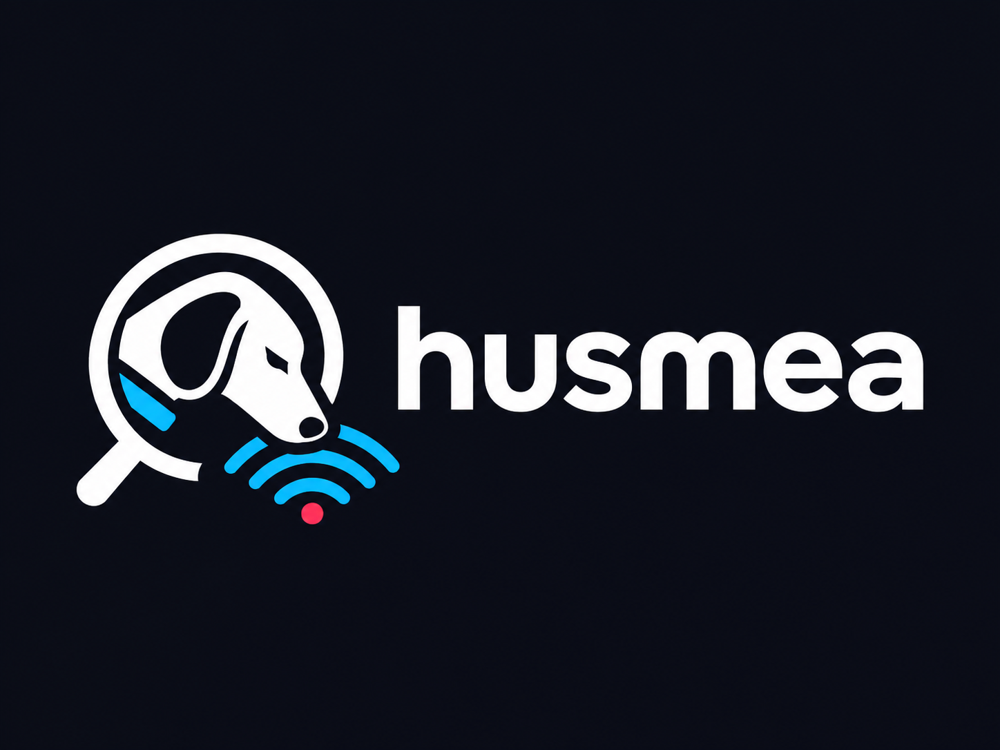

<p align="center">
  
</p>

# husmea

Escáner de amenazas para equipos **Windows y Linux**, **solo de detección**. Revisa los lugares donde suele esconderse el malware (servicios, persistencia, tareas programadas, procesos, red, rutas típicas, configuración de seguridad) y genera un informe con severidad, evidencias y una **recomendación** para cada hallazgo.

> husmea **nunca modifica el sistema**: no borra, no pone en cuarentena y no desactiva nada. Los hallazgos son indicios que deben verificarse antes de actuar.

## Compilación

Requiere Go 1.24+. Se genera un único ejecutable sin dependencias (sin cgo).

```sh
make windows        # dist/husmea.exe (amd64) y dist/husmea-arm64.exe
make linux          # dist/husmea-linux (amd64)
make test           # tests unitarios (se ejecutan en cualquier SO)
# o directamente:
GOOS=windows GOARCH=amd64 go build -o husmea.exe ./cmd/husmea
```

## Uso

### Linux

```sh
sudo ./husmea-linux                      # análisis completo (sin sudo funciona, pero ve menos)
./husmea-linux --checks processes,network,paths
sudo ./husmea-linux --ioc examples/iocs.txt --yara-rules examples/rules
```

### Windows

Ábralo desde una consola (preferiblemente **como administrador**, para que se puedan ver todos los procesos, las tareas y las exclusiones de Defender):

```powershell
.\husmea.exe                                   # análisis completo, informes en .\husmea-reports\
.\husmea.exe --list                            # módulos disponibles
.\husmea.exe --checks services,autoruns,tasks  # solo algunos módulos
.\husmea.exe --skip paths --min-severity medium
.\husmea.exe --ioc examples\iocs.txt --yara-rules examples\rules
$env:VT_API_KEY="..."; .\husmea.exe --vt       # enriquecer con VirusTotal (opcional)
```

| Opción | Descripción |
|---|---|
| `--checks`, `--skip` | Módulos a ejecutar u omitir, separados por comas |
| `--min-severity` | Severidad mínima mostrada en consola (`info`, `low`, `medium`, `high`, `critical`). Los informes incluyen siempre todos los hallazgos |
| `-v` | Mostrar toda la evidencia en consola |
| `--out-dir`, `--json`, `--html`, `--no-report` | Ubicación de los informes |
| `--ioc fichero` | Lista de hashes MD5/SHA1/SHA256 a buscar |
| `--yara-rules ruta`, `--yara-bin ruta` | Reglas YARA y binario `yara64.exe`/`yr.exe` |
| `--vt`, `--vt-max`, `--vt-rate` | Consultas a VirusTotal (solo hashes) |
| `--allowlist fichero.json` | Suprimir falsos positivos conocidos (ver `examples/allowlist.json`) |
| `--deep` | Recorrido más profundo de las rutas (más lento) |
| `--timeout` | Tiempo máximo por módulo (por defecto 10m) |

**Códigos de salida:** `0` sin hallazgos altos o críticos, `1` con hallazgos altos o críticos, `2` error de uso. Útil para automatizarlo.

## Módulos

Los nombres son los mismos en ambos sistemas; cambia lo que inspecciona cada uno.

### Windows

| Módulo | Qué revisa |
|---|---|
| `services` | Servicios y controladores (registro `HKLM\SYSTEM\CurrentControlSet\Services`): binarios en rutas escribibles, sin firma o con la firma alterada; `ServiceDll` de svchost fuera de System32; rutas sin comillas; controladores fuera de `System32\drivers`; servicios huérfanos |
| `autoruns` | Claves Run/RunOnce (HKLM y todos los usuarios cargados), carpetas de Inicio (y sus `.lnk`), Winlogon Shell/Userinit, IFEO Debugger, SilentProcessExit, AppInit_DLLs, AutoRun de cmd, UserInitMprLogonScript y BootExecute |
| `tasks` | Tareas programadas (`System32\Tasks`): acciones con LOLBins o comandos codificados, binarios en rutas de usuario, tareas ocultas y tareas que suplantan a las de `\Microsoft\` |
| `processes` | Procesos: suplantación de nombres del sistema (`svchost.exe` fuera de System32, `scvhost.exe`…), firma, ejecutable borrado del disco, padre anómalo (Office → PowerShell) y línea de comandos sospechosa |
| `network` | Conexiones y puertos por proceso: puertos de RAT y C2 conocidos, procesos sin firma en rutas de usuario con actividad de red, e inventario de los puertos en escucha |
| `paths` | Ejecutables y scripts en `%TEMP%`, `AppData`, `ProgramData`, `Users\Public`, Papelera, `PerfLogs`, `Windows\Tasks`, `Fonts`…; también dobles extensiones y caracteres RTLO |
| `hosts` | Fichero hosts (pharming o bloqueo de antivirus y Windows Update), proxy y PAC del sistema, servidores DNS |
| `defender` | Estado de Microsoft Defender (tiempo real, firmas, Tamper Protection), exclusiones peligrosas, detecciones recientes y antivirus de terceros registrados |

### Linux

En Linux, el equivalente de la firma digital es **pertenecer a un paquete** (dpkg, rpm, pacman o apk). Un binario en `/usr/bin` que no instaló ningún paquete es sospechoso.

| Módulo | Qué revisa |
|---|---|
| `services` | Unidades systemd del sistema y de usuario (incluidos drop-ins): comandos `Exec*` con reverse shells, descargas (`curl … \| sh`), binarios en `/tmp`, `/dev/shm` o en directorios ocultos, binarios del sistema que no pertenecen a ningún paquete y unidades creadas a mano; scripts SysV de `/etc/init.d` |
| `autoruns` | `/etc/ld.so.preload`, ficheros de inicio de shell (`/etc/profile*`, `.bashrc`, `.zshrc`…; incluidos alias que secuestran `sudo`/`ssh`), autostart XDG, `authorized_keys` (y comandos forzados), reglas udev `RUN+=`, PAM (`pam_exec`, módulos fuera de `/security/`), `update-motd.d` y módulos cargados en el arranque |
| `tasks` | `/etc/crontab`, `/etc/cron.d`, crontabs de usuario, `cron.{hourly,daily,…}`, trabajos `at` y timers de systemd |
| `processes` | `/proc`: ejecutable borrado mientras corre, procesos disfrazados de hilos del kernel (`[kworker/0:1]`), shells conectadas a un socket de red (reverse/bind shell), `LD_PRELOAD`, mineros, webshells (Apache/nginx/php-fpm → shell), demonios suplantados y binarios fuera de paquetes |
| `network` | Igual que en Windows, con la política de rutas de Linux |
| `paths` | Binarios ELF y scripts ejecutables en `/tmp`, `/var/tmp`, `/dev/shm`, `/dev`, `/run/user` y directorios ocultos de los perfiles; binarios **SUID/SGID** anómalos (GTFOBins, fuera de paquetes o en rutas de usuario) |
| `hosts` | `/etc/hosts`, `/etc/resolv.conf`, variables de proxy y proxy de APT |
| `system` | Cuentas con UID 0, cuentas sin contraseña, `sudo` con NOPASSWD, configuración de sshd, **módulos del kernel ocultos** (`/sys/module` frente a `/proc/modules`), módulos de rootkits conocidos, kernel *tainted*, ASLR, SELinux/AppArmor, borrado de logs e historial, y ficheros de familias conocidas (Ebury, Kinsing, XOR.DDoS…) |

### Ambos sistemas

| Módulo | Qué revisa |
|---|---|
| `hashes` | *(fase 2)* Hashes de todos los ficheros recopilados frente a la lista `--ioc` |
| `yara` | *(fase 2)* Escaneo de los ficheros recopilados con `yara`/`yara-x` |
| `virustotal` | *(fase 2, online, opcional)* Consulta los hashes de los ficheros más sospechosos |

Los módulos de la fase 1 se ejecutan en paralelo y registran los ficheros que encuentran (binarios de servicios, destinos de autoarranque, procesos…). Después, los módulos de la fase 2 analizan esos ficheros.

### Cómo se puntúa

Cada heurística aporta un motivo con su severidad y su técnica de [MITRE ATT&CK](https://attack.mitre.org/). La severidad del hallazgo es la del motivo más grave y **sube un nivel** cuando coinciden dos o más motivos de severidad media o superior. Por ejemplo, un binario sin firma (medio) en la raíz de `%APPDATA%` (alto) da un hallazgo **crítico**. Los binarios con firma válida instalados por usuario (OneDrive, Teams…) no se marcan solo por su ubicación, salvo en carpetas de alto riesgo como Temp, Public o la Papelera. Las entradas de Microsoft que lanzan intérpretes del sistema tampoco se marcan solo por eso.

## Privacidad y modo online

- Por defecto todo funciona **sin conexión**.
- Con `--vt` se envían a VirusTotal **solo los hashes SHA-256** de un número limitado de ficheros (por defecto 20, a 4 consultas por minuto, el límite de la API gratuita). Nunca se suben ficheros. Las respuestas se guardan en caché durante 7 días en `%LOCALAPPDATA%\husmea\vt-cache.json`.
- La API key se lee de la variable de entorno `VT_API_KEY` y no se guarda en ningún informe.

## Firmas digitales

En Windows, las firmas Authenticode se verifican por lotes con `Get-AuthenticodeSignature`, que admite tanto las firmas incrustadas como las de **catálogo** (la mayoría de los binarios de Windows). PowerShell se invoca siempre por su ruta absoluta (`%SystemRoot%\System32\WindowsPowerShell\v1.0\powershell.exe`).

## Limitaciones

- Sin privilegios de administrador (Windows) o root (Linux) algunos datos no son visibles: rutas de procesos de otros usuarios, tareas y crontabs ajenos, exclusiones de Defender, `/etc/shadow` y `/etc/sudoers`. husmea avisa de lo que no ha podido revisar.
- Es un escáner heurístico: puede dar falsos positivos (use `--allowlist`) y no sustituye a un antivirus ni a un EDR. Un rootkit en modo kernel puede ocultarse de cualquier herramienta que se ejecute en el propio sistema.
- En Linux, un rootkit de kernel puede ocultar procesos y ficheros a cualquier herramienta. La comparación de módulos ayuda, pero ante sospechas lo fiable es analizar el disco desde un sistema de rescate.
- macOS: por ahora solo están disponibles `hosts`, `hashes`, `yara` y `virustotal`. El soporte para launchd y LaunchAgents es la siguiente fase.

## Estructura

```
cmd/husmea/            CLI
internal/core/         Modelo de hallazgos, runner por fases, allowlist, artefactos y hashes
internal/heuristics/   Reglas compartidas (rutas, suplantación, LOLBins, padre/hijo, puertos)
internal/winutil/      Utilidades de Windows: PowerShell, firmas, registro, normalización de rutas
internal/unixutil/     Utilidades de Linux: base de datos de paquetes, usuarios, detección de ELF
internal/checks/       Un paquete por módulo: lógica pura y testeable (rules.go, linux_rules.go…) + recolección por SO (*_windows.go, *_linux.go)
internal/intel/        Cliente de VirusTotal
internal/report/       Consola, JSON y HTML (plantilla embebida)
examples/              Allowlist, lista de IOCs y reglas YARA de ejemplo
```

## Licencia

Distribuido bajo la licencia [Apache 2.0](LICENSE).
